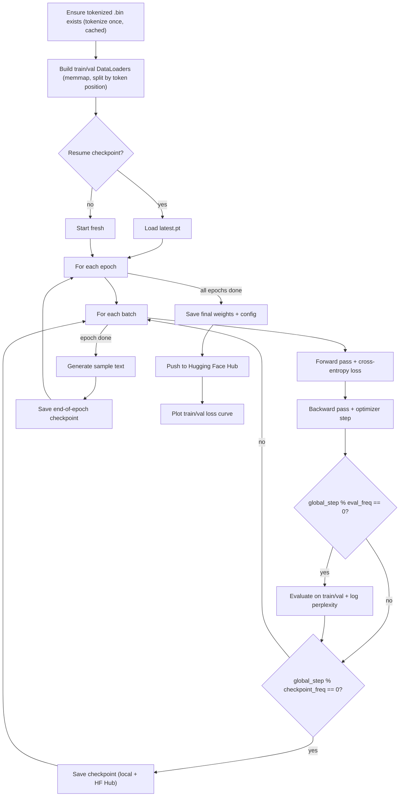

# GPT-2 From Scratch

A from-scratch PyTorch implementation of a GPT-2 style decoder-only transformer, including training, checkpointing, Hugging Face Hub sync, and text generation.

> **Note**: This version only uses a single GPU so if you have more than 1 GPU, this model only uses one of them.

## Features

- Custom `GPT_model` built from token/positional embeddings, stacked transformer blocks, layer norm, and an output head
- Multi-head causal self-attention implemented manually (no `nn.MultiheadAttention`)
- Configurable via `.env` (model size, training hyperparameters, tokenizer, paths)
- Memory-mapped dataset pipeline: JSONL/text corpora are tokenized once to a `uint16` binary file, then streamed via `numpy.memmap`, so RAM usage stays flat regardless of dataset size (multi-GB+ corpora included)
- Training loop with periodic evaluation, perplexity tracking, and loss plotting
- Resumable checkpoints, mirrored automatically to a Hugging Face Hub repo
- Greedy and temperature/top-k sampling for text generation
- Simple CLI (`-t` train, `-g` generate, `-i` info) plus an interactive fallback menu
- This version uses pytorch [`Automatic Mixed Precision (AMP)`](https://docs.pytorch.org/docs/2.14/amp.html), so insted of `float32`, it uses `BF16` to do some of models math operations so we could save 1GB of T4 GPU VRAM (it was a good try for me).
- We also tie the **input and output** embeddings of the decoder which make model so much smaller (around 38M params!).

## Project Structure

```bash
.
├── main.py                          # CLI entry point (train / generate / info)
├── configs/
│   └── model_configs.py             # LLM_configs dataclass + .env loader
├── scripts/
│   ├── evaluation.py                # All functions which we use to evaluate models (including loss function)
│   ├── generation.py                # Some function which used to text generating
│   ├── logger.py                    # Simple logger which logs some stuff for exploring
│   └── lr_warmup_cosinedecay.py     # LR warmup + Cosine decay function is here
├── src/
│   ├── data/
│   │   ├── instruction_dataset/
│   │   │   └── dataset.py          # Instruction dataset handler which converts json to prompt
│   │   └── pretrain_dataset/
│   │       ├── tokenize.py         # One-time corpus -> uint16 .bin tokenization
│   │       ├── dataset.py          # Memmap Dataset, DataLoader, .bin caching
│   │       └── sampler.py          # The resumable sampler class which help us to continue from last checkpoint data index
│   ├── models/
│   │   ├── gpt_model.py             # Top-level GPT_model, a psycho has build this (so you know it is good)
│   │   ├── transformer_block.py
│   │   ├── multi_head_attention.py
│   │   ├── feed_forward.py
│   │   ├── activations.py           # GELU 
│   │   └── normalizers.py           # LayerNorm
│   ├── training/
│   │   ├── pretrain.py              # The pretrain module which we use to pretrain model
│   │   └── instructtrain.py         # The instruction tuning module which we use to do teach model how to follow instructions
│   └── utils/
│       ├── load_model.py            # Load local weights if present
│       ├── save_model_hf.py         # Push model + config to HF Hub
│       └── ckeckpoints.py           # Save/load training checkpoints (local + HF)
├── requirements.txt
└── .env                             # Runtime configuration (not committed with real secrets)
```

## Setup

```bash
pip install -r requirements.txt
```

Configure your run in `.env`:

```env
EPOCHS=1
BATCH_SIZE=4

VOCAB_SIZE=50257
CONTEXT_LENGTH=1024
EMB_DIM=768
N_HEADS=12
N_LAYERS=12
DROP_RATE=0.2
QKV_BIAS=True
TIKTOKEN_TOKENIZER="gpt2"

SEED = 42

DATA_PATH="./data/llm_dataset.jsonl"
SAVE_MODEL_PATH="model-weights/"
REPO_ID="your-username/your-repo"

LR_SCHEDULE_STEP = 0

CHECKPOINT_FREQ=1000
CREAET_CHECKPOINTS=true
USE_CHECKPOINTS=true
CHECKPOINTS_PATH="check-points/"
```

### Dataset tokenization (automatic, cached)

On the first training run, the corpus at `DATA_PATH` is tokenized once and written to a `uint16` binary file next to it (e.g. `./data/llm_dataset.jsonl` $\to$ `./data/llm_dataset.bin`). Every subsequent run reuses that `.bin` file directly via `numpy.memmap` instead of re-tokenizing, and only the token windows actually being read are paged into memory - so a 7GB+ corpus trains with roughly the same RAM footprint as a tiny one. Delete the `.bin` file (or pass `force=True` to `prepare_bin_dataset`) if you change the source data and need to re-tokenize.

If `REPO_ID` is a valid Hugging Face repo id, the app will prompt for login (or read `HF_TOKEN`) and automatically push weights, config, and checkpoints to the Hub.

## Usage

### Train

```bash
python main.py -t
```

Skips training and loads existing weights if `model-weights/pytorch_model.bin` is already present.

### Generate text

```bash
python main.py -g -p "Once upon a time"
```

Or omit `-p` to be prompted interactively.

### Inspect model & config

```bash
python main.py -i
```

### Interactive mode

Run with no flags for a `q` (quit) / `t` (train) / `g` (generate) / `i` (info) menu.

## Training Flow



## Sources

I used [Build a Large Language Model (From Scratch)](https://www.oreilly.com/library/view/build-a-large/9781633437166/) + [Attention Is All You Need](https://arxiv.org/pdf/1706.03762) + [Language Models are Unsupervised Multitask Learners](https://cdn.openai.com/better-language-models/language_models_are_unsupervised_multitask_learners.pdf) + [Using the Output Embedding to Improve Language Models](https://aclanthology.org/E17-2025.pdf) (before this article my model 38M parameter larger than gpt2 small) and the first part of [Hands-On Large Language Models: Language Understanding and Generation](https://www.oreilly.com/library/view/hands-on-large-language/9781098150952/) so I could understand deeply what is going on inside LLMs.

## License

For this repo we use MIT License so feel free to change it or help me to improve.
